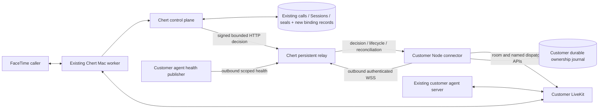

# FaceTime CLI research

Status: **Proposed — awaiting owner review**. Research completed 2026-09-25.
Accepted product direction remains [PLAN.md](PLAN.md). Implementation scope is
proposed in [IMPLEMENTER_HANDOFF.md](IMPLEMENTER_HANDOFF.md); nothing here
authorizes implementation, enrollment, routing changes, deployment, or calls.

## 1. Executive decision

The package-first connector is feasible for a **running, verifiably available,
named LiveKit agent whose fresh per-call preparation fits the current deadline**.
It needs a Chert-operated relay and new enrollment/ownership APIs; an npm package
alone cannot replace the receiver. Recommend a TypeScript WebSocket relay in
`chert-facetime/connector-relay/`, initially one always-on Railway service, and a
customer Node.js companion process in this repository. Preserve the synchronous
BYOR decision, central credential sealing, Sessions, worker commands, and Mac
media path. The relay carries control messages and transient bridge credentials,
never live media.

**No Mac code change or per-Mac connector installation is required for that basic
release at the inspected source revision.** This is source compatibility, not a
fresh audit of installed fleet binaries. It does not establish slow-avatar or
new video support. API registration plus dispatch plus preparation plus decision
commit must also fit inside the Mac's six-second gate, not merely the server's
five-second window. See the timing analysis below.

Availability is the principal onboarding qualification. There is a documented
non-dispatching LiveKit agent health endpoint, but no general worker-enumeration
API in the inspected AgentDispatch service. Health alone does not prove matching
project/name, capacity, or readiness for a particular job. Recommend a small,
authenticated agent-server health publisher plus a per-call readiness/deadline
adapter. This is explicit customer startup/deployment integration work; do not
advertise zero agent changes for arbitrary existing agents. Unknown availability
must disable new acceptance. A Cloud deployment marked Running is insufficient.

The first implementation step, **after review**, should be a loopback-only,
synthetic control-plane → relay → connector experiment using fake agents and
fake credentials. Prove immutable deadlines, generation fencing, duplicate
coalescing, uncertain acceptance, lifecycle acknowledgment, and tenant isolation
before integrating a real provider or changing Chert routes.

## 2. Evidence provenance and coverage

All local source evidence is the working tree observed on 2026-09-25. No fetch,
branch switch, reset, commit, push, environment-file read, credential-store read,
production API/database query, worker start, provider session, or FaceTime call
was performed. Remote currency and actual deployed revisions remain unknown.
Only this CLI repository receives research writes. Public documentation, GitHub
source, and npm metadata were read without account authentication. Public npm
tarballs were inspected in memory, without installing or executing them.

| Checkout under `/Users/garygao/` | Branch and HEAD | Initial dirty state / remote |
| --- | --- | --- |
| `chert-facetime-cli` | `main`; unborn, no HEAD | README, PLAN, CLI_RESEARCH_AGENT already staged as additions; origin `cherthq/chert-facetime-cli` |
| `chert-facetime` | `codex/dashboard-design-review`; `e9dddcda52865d85e6295196cdda5690ab57f736` | Modified README, docs/INDEX, docs/plans/README; untracked patent disclosure, dashboard-cache-release evidence, and four plans (BYOR_CALLER_VIDEO, BYOR_CONNECTOR_PACKAGE, MULTI_ACCOUNT_FACETIME_RESEARCH, OUTBOUND_API); origin `cherthq/chert-facetime` |
| `chert-reference-agent` | `codex/prepare-public-reference`; `1f4d01a43b0d2d21bb38f1041c0e3e18631ce7cf` | Clean; origin **`cherthq/chert-reference-agent-internal`**, not the public repository named in the prompt |
| `chert-facetime-opensource` | `main`; `daabf122ee31f8d3c21bae4ae41433f694635521` | Modified README, GUIDE, PLAN, example agent, package/lock, CLI, hop, type declarations, LiveKit, SDK, hop/SDK tests; untracked handoff, demo guide, lifecycle example/tests, local-network tests; origin `garygao333/chert-facetime-opensource` |
| `demo-agent-0-outbound-video` | `codex/manual-demo`; `faaf867d0b3a988e71d886c859a36faece60aa00` | Clean; origin `cherthq/demo-agent-0` |

The dirty packaging code is evidence of local work, not proof of the published
artifact. The reference checkout's behavior is not claimed to match public main.
Existing edits were preserved. Parent guidance redirects to
`/Users/garygao/orangeslice-docs/AGENTS.md`; that file and the FaceTime root and
control-plane AGENTS were read. No additional AGENTS were found in the other
four repository file inventories.

At final validation, the CLI repository had acquired initial commit
`54db70ba5f18d2cc8d36053352186af6c1287847` on `main`; this research run issued no
commit command. Its final changes are README plus the two new research documents.
The evidence checkouts retained the dirty states recorded above.

Reading coverage:

- CLI README, PLAN, and the full research assignment.
- FaceTime README, CONTEXT, INDEX and its status definitions; SYSTEM and FLEET;
  control-plane README/API_CONTRACT; CONFIGURATION, LOCAL_WORKER_API,
  managed-agent README; line-webhook-editor BRIEF/RELEASE and
  LINE_INTEGRATIONS_ANALYZER_BRIEF; DEVELOPMENT_OPERATIONS,
  CONTROL_PLANE_RELEASE, and SUPERVISED_TEST.
- OUTBOUND_API objective/scope (lines 1–46) and BYOR_CALLER_VIDEO objective,
  scope, source map, and invariants (lines 1–123). They remain proposals. The
  latter points to newer video-framing evidence absent from this checkout;
  that missing evidence was not replaced by a production inquiry.
- Source boundaries in the evidence table below, plus focused registration,
  pinning, reservation, event enqueue, and reconciliation SQL sections. This is
  not an audit of every migration or every Swift/media implementation.
- Reference README, CONTRACT, OPERATIONS; service, journal, configuration,
  adapter preparation/cleanup and focused service/adapter tests. The README's
  historical deployment prompt was treated as reference only.
- Open-source README, GUIDE setup/packaging sections, package manifest, CLI,
  type declarations, and SDK startup. No browser-media code was adopted.
- Demo ON_DEMAND_AVATAR and newer MANUAL_DEMO; preparation helper, agent request
  handler, BYOR metadata validation, Muse startup, avatar adapter/service, and
  preparation/startup test sections. No raw logs or `.local` evidence were read.

### Source evidence map

Links open local files at exact starting lines; ranges below delimit the inspected
behavior. `F` means source fact, `H` historical evidence, `P` proposal, and `U`
unknown. Tests cited here were **read, not executed**.

| Ref | Evidence and relevant lines | Finding |
| --- | --- | --- |
| S1 | [webhook-core.ts](/Users/garygao/chert-facetime/control-plane/src/lib/facetime/webhook-core.ts:7), 7–21, 73–176 | F: HMAC-SHA256 over exact bytes; default 5,000 ms; stable event envelope; remaining absolute budget; up to 100 ms completion margin; no redirects; accept/decline parsing and shared credential handoff |
| S2 | [byor-credentials.ts](/Users/garygao/chert-facetime/control-plane/src/lib/facetime/byor-credentials.ts:32), 32–87 | F: secure URL shape, size bounds, integer nbf/exp, one room, join/publish/subscribe grants, distinct bridge/remote identity, maximum two-hour validity |
| S3 | [store.ts](/Users/garygao/chert-facetime/control-plane/src/lib/facetime/store.ts:695), 695–825; [credential-seal.ts](/Users/garygao/chert-facetime/control-plane/src/lib/facetime/credential-seal.ts:10), 10–49 | F: configured deadline passed to registration; pinned context decoded; AES-256-GCM with project/Session/worker/field AAD; credential redemption and transient plaintext |
| S4 | [line-integrations migration](/Users/garygao/chert-facetime/control-plane/supabase/migrations/20260911131327_line_integrations.sql:177), 177–265, 371–496, 544–636 | F: immutable line identity and call pins; line/integration locks; duplicate source ownership check; reservations; deadline/revocation/status recheck at acceptance; one committed Session |
| S5 | [sealed-credentials migration](/Users/garygao/chert-facetime/control-plane/supabase/migrations/0012_b4_sealed_credentials.sql:35), 35–70, 152–196 | F: credential-free `start_bridge` linkage; exact worker/Session/command/lease checks; one-use redemption clears ciphertext; terminal seal tombstone |
| S6 | [event route](/Users/garygao/chert-facetime/control-plane/app/api/internal/v1/calls/[callId]/events/route.ts:6), 6–66; [dispatcher](/Users/garygao/chert-facetime/control-plane/src/lib/facetime/webhook-core.ts:188), 188–297; [cron](/Users/garygao/chert-facetime/control-plane/vercel.json:1) | F: synchronous incoming decision; fire-and-forget lifecycle wake; minute cron; leased at-least-once delivery, default five attempts and exponential backoff; dispatch fetch has no explicit per-send abort here |
| S7 | [event enqueue SQL](/Users/garygao/chert-facetime/control-plane/supabase/migrations/20260911131327_line_integrations.sql:283), 283–360, 808–825 | F: started/ended/failed mapping, logical transition dedup, original revision/signing version/serialized bytes; revoked signing can block terminal delivery |
| S8 | [auth.ts](/Users/garygao/chert-facetime/control-plane/src/lib/facetime/auth.ts:18), 18–83; [data-access.ts](/Users/garygao/chert-facetime/control-plane/src/lib/facetime/data-access.ts:15), 15–48; [projects route](/Users/garygao/chert-facetime/control-plane/app/api/v1/projects/route.ts:6); [API keys route](/Users/garygao/chert-facetime/control-plane/app/api/v1/api-keys/route.ts:11) | F: Supabase getUser plus membership; project-scoped ftk read/write keys; viewer write denial; owner user required for key creation; projects list is user-authenticated |
| S9 | [line table](/Users/garygao/chert-facetime/control-plane/supabase/migrations/0001_facetime_control_plane.sql:129), 129–146, 249–255 | F: no one-line-per-project uniqueness; unique active call per line/worker. U: production project cardinality |
| S10 | [decision gate](/Users/garygao/chert-facetime/Sources/ChertFaceTimeLab/FaceTimeCallControl.swift:160), 160–188, 1356–1371, 1549–1679; [CLI construction](/Users/garygao/chert-facetime/Sources/ChertFaceTimeLab/CLI.swift:874), 874–881 | F: six-second default, production constructor supplies no override; late/error declines; exact local answer claim; watcher awaits decision before resuming detection |
| S11 | [ControlPlaneClient.swift](/Users/garygao/chert-facetime/Sources/ChertFaceTimeLab/ControlPlaneClient.swift:290), 290–306, 487–540, 925–958, 1024–1045 | F: six-second decision HTTP timeout in both direct/outbox paths; durable event acknowledgment; bridge command redeems through worker-authenticated endpoint |
| S12 | [CallMediaCoordinator.swift](/Users/garygao/chert-facetime/Sources/ChertFaceTimeLab/CallMediaCoordinator.swift:751), 751–845; [bridge construction](/Users/garygao/chert-facetime/Sources/ChertFaceTimeLab/LiveKitFullBridge.swift:801), 801–808 | F: waits for FaceTime active within min(lease expiry, now+60s), then redeems; structural and audio-ready callbacks differ; actual track/structural/post-activation limits 10/5/10s |
| S13 | [production media selection](/Users/garygao/chert-facetime/Sources/ChertFaceTimeLab/CallMediaCoordinator.swift:439); [WorkerBYORTests](/Users/garygao/chert-facetime/Tests/ChertFaceTimeLabTests/WorkerBYORTests.swift:208), 208–294, 335–447, 467–686 | F: production caller-video capture suppressed; sole eligible audio publisher/SID lock intentional. Tests cover late decision, one-use credentials, audio gate, delayed activation |
| S14 | [failure reconciliation](/Users/garygao/chert-facetime/control-plane/supabase/migrations/0017_start_bridge_failure_reconciliation.sql:6), 6–108; [decline cleanup](/Users/garygao/chert-facetime/control-plane/supabase/migrations/0016_incoming_webhook_decline_cleanup.sql:30) | F: exact call/Session/worker/line/command reconciliation and reservation release; never clear a newer current_call_id |
| S15 | [reference service](/Users/garygao/chert-reference-agent/src/chert_reference_agent/service.py:56), 56–180, 182–299; [journal](/Users/garygao/chert-reference-agent/src/chert_reference_agent/journal.py:16), 16–67 | F: signed mode, event digest conflict, shared preparation, terminal suppression, receipt-before-effect, fsync/rename/flock, cleanup debt blocks readiness; restart deletes all receipted rooms |
| S16 | [reference adapter](/Users/garygao/chert-reference-agent/src/chert_reference_agent/livekit_adapter.py:227), 227–315; [config](/Users/garygao/chert-reference-agent/src/chert_reference_agent/config.py:20) | F: four-second default, room-scoped token, tone/color-bar publication and first-submission gate; deletion followed by absence check. It does not dispatch a named agent |
| S17 | [demo deadline](/Users/garygao/demo-agent-0-outbound-video/src/preparation.mjs:1), 1–19; [request handler](/Users/garygao/demo-agent-0-outbound-video/src/agent.mjs:28), 28–37; [Muse startup](/Users/garygao/demo-agent-0-outbound-video/src/muse/index.mjs:16), 16–17, 86–148 | F: late-dispatch check before provider work, bounded preparation, cleanup on failure. Promise.race alone does not abort an underlying operation |
| S18 | [avatar adapter](/Users/garygao/demo-agent-0-outbound-video/receiver/src/chert_reference_agent/avatar_adapter.py:38), 38–96; [avatar service](/Users/garygao/demo-agent-0-outbound-video/receiver/src/chert_reference_agent/avatar_service.py:58) | F: named dispatch with absolute prepare deadline; exact participant attributes and publications; this is per-call readiness, not idle agent health |
| S19 | [ON_DEMAND_AVATAR](/Users/garygao/demo-agent-0-outbound-video/docs/ON_DEMAND_AVATAR.md:64); [MANUAL_DEMO](/Users/garygao/demo-agent-0-outbound-video/docs/MANUAL_DEMO.md:1) | H: 6,855 ms Muse cold start; rotating paid pool removed; newer manual one-call preparation has 45s prep, 120s arrival, 600s total, 20s lease. Not current production verification |
| S20 | [package.json](/Users/garygao/chert-facetime-opensource/package.json:1); [CLI](/Users/garygao/chert-facetime-opensource/src/cli.mjs:1); [SDK](/Users/garygao/chert-facetime-opensource/src/sdk.mjs:1) | F, dirty tree: ESM/bin/files/prepack/types patterns; browser media and Playwright are unrelated to this connector |

Important reconciliations:

1. Reference documentation defaults to unsigned webhooks and describes a signing
   checkbox. Current Chert sender always signs; current integration schemas and
   editor have no matching unsigned-mode contract. Keep internal signing enabled;
   do not port that onboarding advice. Reference ahead-of-call prewarming advice
   is also superseded by this project's explicit prohibition on paid warming.
2. The current webhook **body has no deadline** although the database context
   does. A relay implementation must add authenticated internal deadline/context
   propagation. Forwarding the old JSON untouched cannot establish the requested
   end-to-end protocol.
3. Credential validation decodes JWT claims; it does **not** cryptographically
   verify a customer's LiveKit JWT signature. LiveKit verifies it on join. Do not
   describe Chert as possessing the customer's signing key or proving live access
   merely from validation. Host metadata is intentionally non-enforcing; do not
   reintroduce a host allowlist as an incidental CLI change.
4. Line integration generations are provenance, not existing compare-and-swap
   protection. The accepted Analyzer amendment permits last-successful-write-wins
   for ordinary configuration. New connector activation needs stronger explicit
   ownership/CAS semantics without silently changing legacy editor semantics.
5. LOCAL_WORKER_API and parts of control-plane README/DEVELOPMENT_OPERATIONS
   retain historical deferred/BlackHole/deployment claims. Current source and
   API_CONTRACT prevail. SYSTEM's September 6 video observation is historical;
   the later caller-video plan references absent newer evidence. No general
   statement about today's deployed video capability is justified here.
6. `FullBridgeReadinessTimeouts.production` says 30s expected-track timeout
   ([definition](/Users/garygao/chert-facetime/Sources/ChertFaceTimeLab/LiveKitFullBridge.swift:261));
   actual bridge construction uses **10s** (S12). Test injection/default constants
   must not be mistaken for production configuration.

## 3. Proposed developer walkthrough

All commands below are proposed, not executable features of this repository.

1. Install a pinned runtime dependency with `npm install @trychert/facetime-cli`
   and commit the lockfile. `npx chert login` opens Chert's browser approval page;
   the CLI never asks for a Chert password.
2. `npx chert init` lists accessible projects by display name, persists the
   selected stable project ID, resolves its single line, and shows its masked
   display for confirmation. Zero lines means provisioning required; multiple
   lines means explicit compatibility resolution required. No guessed first line.
3. Reuse LiveKit environment variable **names**, select the dispatch name and
   deployment, and identify the agent-health adapter. Read safe TOML/package
   configuration without executing customer code or reading secrets into
   diagnostics. A dispatch name is not a participant identity. Onboarding can
   accept a user-supplied name when Cloud inventory is unavailable; it cannot
   mark that name available without health evidence.
4. Install the documented small agent startup/health and per-job hooks if the
   agent lacks them. The developer runs their server normally. Hooks preserve
   prompts, tools, conversation engine, and media provider.
5. `npx chert check --json` checks configuration, authorization, line mapping,
   LiveKit management access, agent health freshness, capacity and cleanup state
   separately. It creates no room/job/avatar. Passing is readiness for admission,
   not media acceptance. Failure exits nonzero with a stable code.
6. `npx chert run` connects in standby unless this exact environment/binding has
   been activated. A separate `chert activate --environment development` displays
   project/line/current owner and requires an explicit handoff when production
   owns it. Noninteractive activation requires the intended binding and expected
   generation. `init`, install, `check`, and a second `run` never steal routing.
7. Deploy the pinned connector as a companion container/process using
   `"chert:start": "chert run"`, protected secret injection and persistent state.
   `chert deploy-config --target docker` generates reviewed instructions and
   examples; it does not start/deploy the agent. A separate service is suitable
   when the agent host cannot run companions. Production enrollment gets its own
   revocable credential. Check, activate explicitly, then drain the old connector.

Report “Agent unavailable. Start your configured LiveKit agent server, then run
`npx chert check` again. FaceTime call acceptance is disabled.” only for evidence
of unavailability. For absent/unverifiable evidence say “Agent availability
unknown” with the missing health integration, not “stopped.” Recovery enables
admission only within an already activated binding.

## 4. Architecture, hosting, and ownership



| Repository/service | Proposed responsibility |
| --- | --- |
| This repository | Compiled CLI, private connector modules, schemas, diagnostics, journal, LiveKit adapter, deployment examples; no public SDK |
| `chert-facetime/control-plane` | Browser approval, membership authorization, enrollment/rotation, atomic binding, call pin and commit guards, internal relay destination/signing, durable lifecycle and reconciliation APIs, dashboard |
| `chert-facetime/connector-relay` | Separately built/operated Node service; authenticated sockets, bounded HTTP-to-socket RPC, connection leases/fencing, health delivery, lifecycle consumer; no customer master keys or independent call state machine |
| Customer agent deployment | Existing agent plus health/readiness/deadline hooks; provider shutdown; no automatic agent launcher in connector |
| Existing Macs | Unchanged basic worker protocol/media path; future slow-start work is separately reviewed |

Recommend **Railway, one always-on relay replica, sleep disabled**, near the
control plane/database, with explicit application connection leases. Railway
documents HTTP/1.1 WebSockets exempt from its ordinary HTTP duration/inactivity
limits. This avoids compulsory short connection turnover. It does not eliminate
network failures or deploy disconnects. [Railway networking limits](https://docs.railway.com/networking/public-networking/specs-and-limits).

Keep relay durable state in the central database through scoped internal APIs;
no relay volume is necessary. The initial singleton avoids cross-instance RPC
routing. Each relay boot acquires a fenced lease; loss of renewal disables new
dispatch. Do not enable replicas until a reviewed owner-directory and transient
cross-node RPC design exists. An accidental second instance fails closed instead
of routing calls to an arbitrary socket.

Customer connector deployments need a durable journal volume. Railway volumes
cannot be shared by replicas, and volume redeploys have downtime. Therefore the
initial production example drains to zero **before** redeploying the connector;
do not promise rolling overlap on the same volume. Configure graceful shutdown
and verify UID write access. [Railway volumes](https://docs.railway.com/volumes/reference).
Railway sends SIGTERM before SIGKILL and exposes overlap/draining controls, but
those alone do not preserve application ownership. [Deployment teardown](https://docs.railway.com/deployments/deployment-teardown).

Alternatives:

| Option | Assessment |
| --- | --- |
| Vercel WebSockets + external coordination | Viable alternative to prototype. The June 22, 2026 official KB explicitly says native WebSockets are supported, pinned only for the function's maximum duration, without affinity for future connections. Older limits-page search content contradicts it. Do not repeat the outdated blanket prohibition. More reconnect/cross-instance coordination than the recommended singleton; no proof the current Next app is configured for it. [Current KB](https://vercel.com/kb/guide/do-vercel-serverless-functions-support-websocket-connections), [official example](https://vercel.com/kb/guide/real-time-chat-websockets) |
| Always-on VM/container on another host | Same application design is portable; requires independently verified TLS, connection, persistence and shutdown behavior. No second host is advertised as tested here |
| Long polling or SSE + POST | Possible outbound transport, but adds request turnover, a separate response channel and more deadline-sensitive state; no advantage for the narrow pilot |
| Existing cron webhook queue alone | Insufficient for synchronous decisions and prompt cleanup. A minute fallback and unawaited wake are not an acknowledgment/reconciliation protocol (S6) |

### Crossing the existing decision boundary

Propose a server-owned integration transport discriminator, `connector_v1`,
alongside existing customer `webhook_v1`. Enrollment atomically creates an
internal integration/revision and signing version using existing custody, with
a destination from a Chert-controlled relay-origin registry. Customer API input
cannot set or rewrite this internal destination, transport, binding or key.
No secret is returned for customer receiver setup. Dashboard presents connector
binding/health instead of an editable webhook URL for these records.

Pin integration revision **and connector binding epoch/instance ownership** in
the incoming registration transaction before emitting any request. Keep network
work outside database locks. The synchronous path is:

1. Existing worker event registration obtains call/source/request IDs and the
   persisted `incoming_decision_deadline_at` (S3/S4).
2. The internal transport wraps the existing sanitized incoming payload with
   authenticated project, line, revision, binding epoch, connection generation,
   original absolute deadline, preparation deadline and remaining budget. Sign
   the exact internal bytes with the pinned integration signing version; also
   authenticate the control-plane service. This is a new internal envelope, not
   an undocumented change to customers' existing webhook body.
3. Relay verifies the internal origin/signature, payload limit, tenant/binding,
   epoch and live connection lease; sends to that connector. No socket or stale
   health means an immediate decline. Queuing cannot extend the deadline.
4. Connector coalesces the request, checks fresh health/capacity, journals intent,
   prepares a unique room/job, and replies with the existing acceptance fields.
5. Relay returns the response only on the matching open HTTP request while its
   generation/deadline remains valid. Control plane uses the current credential
   validator and sealing path. A new transactional connector guard checks the
   pinned owner, response generation, terminal state and revocation **in the
   same transaction** as `facetime_commit_incoming_byor_decision`.
6. A separate `decision.committed` receipt or reconciliation reports durable
   accept/decline. Socket delivery or an HTTP 200 from the relay is not a commit.
   The ordinary Mac response remains `{action:"accept"}` or decline.

Use HTTPS only, no redirects, allowlisted internal origins and reviewed DNS/egress
policy. Existing webhook URL validation rejects obvious private hostnames/IPs
but does not itself establish a complete DNS-rebinding defense
([validator](/Users/garygao/chert-facetime/control-plane/src/lib/facetime/webhook-endpoint.ts:29)).
Internal transport must not relax customer webhook destination validation.

## 5. Proposed version-1 protocol and authorization

This is a contract proposal, not implemented JSON Schema. Use a discriminated
union with exact schemas, size limits (initial maximum 32 KiB/frame), bounded
strings/lists, and rejection of unknown major versions. Do not accept arbitrary
metadata passthrough. Opaque IDs below are placeholders.

```json
{
  "v": 1,
  "type": "call.incoming",
  "message_id": "opaque-message-id",
  "binding_id": "opaque-binding-id",
  "binding_epoch": 7,
  "connection_generation": 12,
  "project_id": "opaque-project-id",
  "line_id": "opaque-line-id",
  "call_id": "opaque-call-id",
  "request_id": "immutable-incoming-request-id",
  "integration_revision_id": "pinned-revision-id",
  "created_at": "2026-09-25T12:00:00.000Z",
  "deadline_at": "2026-09-25T12:00:05.000Z",
  "prepare_deadline_at": "2026-09-25T12:00:04.000Z",
  "remaining_ms": 3800,
  "media": {"audio": true, "video": false}
}
```

| Message | Required additional data and semantics |
| --- | --- |
| `connection.hello` → `connection.welcome` | Supported protocol versions, connector version, instance ID, config digest and last lifecycle cursor; server returns authoritative scope, new generation, lease expiry, server time, active/standby/draining role. Auth token is in upgrade Authorization header, never query string |
| `call.incoming` | Above immutable identifiers/deadlines. Retries use the same request ID and semantic digest; message ID can differ |
| `call.decision` | Same ownership tuple and request ID; `action: accept` plus `livekit_url`, `participant_token`, `remote_participant_identity`, or `action: decline` plus allowlisted reason. Acceptance body is transient only |
| `decision.committed` | Request ID, authoritative decision, Session ID if accepted, call version and resource expiry; no token/URL |
| `call.cancel` / `cancel.ack` | Exact call/request, terminal version, bounded reason (`deadline`, `caller_cancelled`, `revoked`, `superseded`, `terminal`), authoritative decision status. Persist terminal marker, abort preparation. If acceptance might have committed, reconcile before deletion |
| `call.lifecycle` / `lifecycle.ack` | Stable event ID, per-binding cursor, call/Session IDs, call version, transition and reason. Ack only after secret-free durable receipt; cleanup completion is separate. Duplicate ack is safe; gaps trigger reconcile |
| `connector.health` | Role, capacity, cleanup debt, agent availability state, observation age, adapter version, config digest; no arbitrary provider diagnostics |
| `agent.health` | Authenticated health publisher identity, boot ID, monotonic sequence, challenge/observation time, project fingerprint, dispatch name/deployment, connected/draining flags, admission capacity or explicit unknown; independent from room readiness |
| `reconcile.request` / `reconcile.result` | At most 100 journal call/request IDs and last cursor; authoritative per-call decision, terminality, owner epoch, Session, resource expiry and missing events. Per-ID forbidden/not-found is not evidence authorizing cleanup |
| `binding.drain` / `binding.drained` | Stop assignment of new requests; accepted calls retain owner; completion means all accepted calls reconciled and cleanup receipts cleared |
| `error` | Versioned stable code, retryable boolean, retry-after if applicable, opaque correlation ID. Never echo a rejected body |

Connection generation is a transport fence; binding epoch is a routing-ownership
fence. Only the server increments either. Exactly one active new-call owner is
allowed per project/line; a replacement may connect in standby. Reconnect of the
same durable instance increments generation. Old-generation decisions are
rejected, and a pending old request is reconciled, not automatically re-dispatched
under a new generation. The conservative first release declines undecided work
interrupted by reconnect. Already committed calls continue through authenticated
reconciliation by their original owner; a fresh deployment cannot claim them just
by knowing a call ID.

Deduplicate by `(project, binding epoch, call, request)` and immutable payload
digest. Exclude delivery-specific message IDs, remaining budget and transport
metadata from that digest; separately validate their ownership and deadline
constraints. Conflicting semantic reuse fails. Persist the owned room/job intent before any
side effect, and persist `decision_sent` before writing acceptance to the socket.
Keep response credentials in memory only until receipt/deadline. After restart,
never mint a new response or new dispatch to replace an ambiguous old one. Terminal
versions dominate delayed incoming/started messages; bounded tombstones and a
server-retained call record prevent replay from resurrecting work.

### Browser login and production credentials

Recommend a Chert-owned device approval flow patterned on
[RFC 8628](https://www.rfc-editor.org/rfc/rfc8628): short-lived device code, visible
user code, browser verification and paced polling. Browser uses existing Supabase
sign-in; server checks membership/owner role when approving and again when
enrolling or activating. CLI polls with its high-entropy device secret, never the
short user code alone. Bind the approval to the displayed CLI instance and scopes,
expire in ten minutes, permit one exchange, rate-limit guesses and return
pending/slow-down/denied/expired errors. This is **new Chert auth work**, not a
claim that the installed Supabase version supplies device grant endpoints.

Proposed separation:

- Developer session: short access token (15 minutes), rotating refresh credential
  (14 days), user/membership-bound; revocable at logout. Store with a protected
  credential-store adapter or explicit owner-only file fallback (directory 700,
  file 600 on supported POSIX hosts); never put it in project configuration.
- Enrollment: owner-authorized, ten-minute, single-use code bound to project,
  line, environment, binding and instance. Idempotency keys plus read-back resolve
  lost enrollment responses; a lost one-time secret needs revoke/reissue, not a
  general plaintext secret-read endpoint.
- Production connector credential: separate random opaque credential, keyed hash
  at rest, proposed 90-day expiry and explicit rotation. Its scope is connect,
  decision for assigned calls, lifecycle ack, health and scoped reconcile. It
  cannot edit integrations, move a line, activate itself, create project keys,
  invoke worker redemption, or access transcripts. Rotation allows a bounded
  overlap; revocation immediately blocks new authorization and commit.
- Socket access ticket: proposed five-minute expiry, relay audience, binding,
  instance, environment and capability claims. Reauthenticate before expiry;
  database commit still rechecks revocation so a cached ticket cannot win a race.
  If auth/lease renewal fails, disable new work and preserve accepted media.
- Agent health credential: different, health-write-only credential tied to the
  configured agent/binding, with boot IDs and freshness challenges. No decision,
  token minting or routing privileges.

A revoked connector is not authorized to keep receiving new calls. Previously
accepted calls retain their call ownership and expiry. Allow an independently
scoped, call-limited cleanup/reconcile capability until that expiry, or require
owner-issued recovery credentials if all credentials were compromised. Do not
equate credential rotation with terminating live media.

Keep `LIVEKIT_API_KEY` and `LIVEKIT_API_SECRET` in customer secret storage. Only
short-lived call-scoped bridge material traverses connector→relay→control plane.
No raw token, URL, room identity, provider key, request/response body or heap dump
belongs in generic queues, logs, traces or diagnostics. Disable host body capture.
JavaScript strings cannot promise physical zeroization; minimize copies/lifetime
and clear references. Durable central custody remains the existing encrypted seal.

All new tables should be server-only with explicit grants/RLS; any privileged RPC
needs a fixed search path, revoked public execution and project/ownership checks.
Review actual Data API exposure rather than assuming schema creation grants
access: Supabase documents changing default exposure behavior.
[Securing the Data API](https://supabase.com/docs/guides/api/securing-your-api),
[exposure change](https://supabase.com/changelog/45329-breaking-change-tables-not-exposed-to-data-and-graphql-api-automatically).

## 6. Agent availability and dispatch compatibility

### What the supported interfaces establish

LiveKit documents explicit dispatch by name, with an optional deployment selector;
the SDK example creates a dispatch and lists dispatches **for a room**. Neither
operation is an idle-worker census. Dispatch can allocate a room and start paid
work, so it is excluded from `check`. [Agent dispatch](https://docs.livekit.io/agents/server/agent-dispatch/).

The public AgentDispatchService documents Create/Delete/List and requires roomAdmin
authorization. Create can create the room automatically. Current documentation
also describes a Cloud restart policy; do not assume failed jobs never restart.
[AgentDispatchService](https://docs.livekit.io/reference/agents/agent-dispatch-service-api/).
Use the official server SDK. Public registry metadata read today reports
`livekit-server-sdk 2.19.1` (Node >=19) and `@livekit/agents 1.9.0`.
[Server SDK metadata](https://registry.npmjs.org/livekit-server-sdk/latest),
[Agents metadata](https://registry.npmjs.org/@livekit%2fagents/latest).
Pin reviewed versions in implementation; latest docs may exceed the customer's
installed version. The 2.19.1 tarball exposes `deployment`, `restartPolicy`, and
`requestTimeout` **in seconds**, with Cloud failover defaulting true. Bound each
request by the remaining deadline; disable automatic create failover/retry until
its duplicate semantics are proven. Explicitly select no automatic job restart
where supported and test it; late-deadline hooks remain required regardless.

The documented agent HTTP `/` health endpoint reports 200 when connected and
operating, 503 on failures; default production port is 8081, dev port is random.
Load-based availability is separate. [Server options](https://docs.livekit.io/agents/server/options/).
Version-specific source confirms the limitation: in JS 1.9.0, health checks
connection/inference, while `/worker` reports name, deployment, job count and SDK
version, without project identity, load threshold or draining status. These
endpoints contain no built-in caller authentication. `/worker` is a real **local
SDK endpoint**, not a public LiveKit fleet-list API or an independently sufficient
availability contract.
[1.9.0 worker source, lines 423–453](https://github.com/livekit/agents-js/blob/ee19759b76dcb17c8f3f1c398ccc9b5f9e4a17b6/agents/src/worker.ts#L423),
[HTTP source, lines 38–54](https://github.com/livekit/agents-js/blob/ee19759b76dcb17c8f3f1c398ccc9b5f9e4a17b6/agents/src/http_server.ts#L38).

Cloud `lk agent status --id` and `lk agent list` provide useful deployment
discovery/status. Documentation includes Running, Sleeping and Waking states.
It does not establish a stable generic runtime worker-availability API for this
package. Treat those as diagnostics, not the admission predicate; don't scrape
human CLI tables for correctness. [Cloud agent commands](https://docs.livekit.io/reference/developer-tools/livekit-cli/agent/).

### Recommended narrow availability contract

An authenticated publisher starts at the **agent-server level**, outside the
per-call entrypoint. It samples the local SDK health endpoint without creating a
room, binds the observation to the configured LiveKit project fingerprint and
dispatch name/deployment, and reports the application's draining/admission state.
The package can provide a documented version-pinned TypeScript example; this does
not require creating the future SDK package. Compose existing request/load
callbacks; do not replace customer policy or introspect private SDK fields.
The extra publisher only reports health; it never starts/restarts the server.

For the first controlled pilot, use one selected agent server/dispatch name and
capacity one, with explicit application admission accounting. A multi-replica
Cloud fleet needs a reviewed aggregate health contract before its capacity can
be declared verified. A hook that reports only process liveness is insufficient.
If SDK drain/load visibility cannot be obtained through supported callbacks and
the customer cannot supply that state, return unknown; implementation must prove
this adapter before advertising the corresponding hosting path.

Proposed sample interval two seconds; maximum observation age five seconds.
Use authenticated challenge/response, boot ID and monotonic sequence so replayed
healthy packets cannot refresh availability. Track receipt age with a monotonic
clock. Validate bounded wall-clock skew; no healthy inference from missing data.

| State | Evidence and action |
| --- | --- |
| `available` | Fresh authenticated matching registration/health, not draining, known positive admission capacity, connector journal healthy; permits trying a bounded per-call preparation |
| `unavailable` | Fresh matching signal explicitly disconnected, stopped/draining, or unhealthy; decline and warn |
| `unknown` | No authenticated signal, unsupported adapter/version, ambiguous project/name/deployment, auth failure or unverifiable capacity; decline without claiming stopped |
| `stale` | Previously verified signal exceeds five seconds or challenge/sequence fails; disable new calls immediately |
| `capacity_exhausted` | Fresh healthy server but no known slot, or connector capacity reserved; decline as busy, not stopped |
| `recovered` | Fresh matching signal restores positive capacity; return to available only for an already activated binding; preserve existing calls throughout |

| Agent hosting | Non-dispatching path | Initial support position |
| --- | --- | --- |
| Local Node agent | Fixed loopback health port, version-pinned startup publisher and admission/readiness hooks | First validation target; no local PID inference |
| Self-hosted Node agent, Cloud or self-hosted LiveKit server | Same publisher over outbound authenticated HTTPS/WSS; private health sampler colocated with agent | Same protocol; separately test project/name and capacity evidence, TLS and reconnect |
| LiveKit Cloud agent | Cloud status for discovery plus startup publisher inside agent container; connector runs elsewhere | Conditional until deployed hook is validated. Cloud status alone remains unknown; sleeping servers are not warmed by health checks |
| Python named agent | Same dispatch protocol and language-neutral health/readiness contract | Compatible in principle; pin/test Python hook separately. Python runtime belongs to agent, never connector |
| Fixed-room script / no verifiable server signal | No supported idle named-agent evidence | Unsupported first release; `agent_availability_unknown` |

A passing health check is not a reservation. The real request handler may still
reject the job. Server availability, dispatch accepted, job running, media prepared,
Mac structural readiness and caller-heard audio are separate observations.

### Fresh session preparation

Before effects, write a receipt with opaque call/request owner, random room name,
project fingerprint, expiry and unique operation ID. Create only a fresh owned
room, with metadata containing opaque ownership and adapter version; refuse to
adopt an existing room with a mismatching SID/marker. Dispatch the selected
name/deployment once. Metadata supplies the immutable request, agent/bridge
identities, absolute preparation/resource deadlines and per-call nonce, never
master keys or bridge token.

The agent request hook validates metadata and deadline **before** accepting; the
entrypoint repeats the check before provider calls. Every asynchronous completion
checks cancellation/deadline, and shutdown callbacks clean late-created provider
resources. A timeout wrapper alone cannot cancel an in-flight vendor API (S17).
An ambiguous CreateDispatch result is reconciled by exact owned room/metadata,
never retried blindly. If absence cannot be established, decline and retain
cleanup debt rather than risk two paid jobs. No standby pool or automatic refill.

Require adapter-reported session preparation and an actual sole unmuted remote
audio publication in the exact owned room before accepting. Bind ready evidence
to the expected job/identity/nonce and freshness, not an arbitrary participant's
`ready=true`. A requestFunc can accept the instructed participant identity (as
the demo does); an adapter may instead resolve the actual job participant through
supported dispatch/job information. Either must reject ambiguity and keep bridge
identity distinct. Silent auxiliary avatar participants are allowed only when
one participant publishes speech. Adapters must avoid simultaneous raw-agent
and avatar speech publications.

Do not wait for the FaceTime participant or caller audio/video before acceptance:
the Mac joins only after acceptance/answer. Do not require spoken greeting as a
pre-answer check. Prepare the audio pipeline and agent session first, then let
the verified bridge arrival activate the greeting. The Mac retains its existing
post-answer non-silent-audio gate; a speech-only-on-user-input agent may need an
explicit greeting/activation adaptation to pass it. Avatar readiness, when an
explicit supported adapter requires it, must also finish within the decision
budget. This does not advertise a new FaceTime video feature.

## 7. Timing and Mac compatibility

| Boundary | Verified value / configuration path | Implication |
| --- | --- | --- |
| Reference receiver | 4,000 ms from event created_at; config default, S15/S16 | Historical receiver margin; not a new central deadline |
| Central registration | Normally 5,000 ms; environment `CHERT_WEBHOOK_INCOMING_DEADLINE_MS` reaches registration SQL via store; SQL fallback 5s, S1/S3/S4 | Persisted once. Retry cannot renew it |
| Central HTTP send | min(configured budget, persisted deadline-now), minus min(100 ms, 75% remaining), S1 | 4.9s maximum from a fresh 5s send budget; validation/commit must still finish |
| Mac decision gate | Six seconds using ContinuousClock; constructor injectable, production CLI supplies no timeout argument, S10 | No inspected production env/config knob changes this |
| Mac decision HTTP | Literal six seconds, direct and durable-outbox paths, S11 | Changing only the API environment cannot extend Mac wait |
| Mac inbound observation | 250 ms scan interval, two detections; registered-call disappearance threshold 20 misses; watcher awaits decision, S10 | Native hangup is not guaranteed to produce prompt cancellation while decision is pending |
| Post-accept bridge | FaceTime-active wait bounded by lease and 60s; track/structural/audio 10/5/10s at actual construction, S12 | These are later-stage limits, not extra incoming-decision time |
| Muse historical cold start | 6,855 ms, S19 | Already exceeds 4/5/6s before relay overhead; not a p95 or current benchmark |
| Newer manual demo | Explicit one-call pre-preparation, up to 45s; S19 | Different paid operator workflow, not evidence cold incoming calls now fit |
| Proposed connector preparation | `min(created_at+4s, deadline_at-1s)`; also cap by signed remaining budget minus transit/skew | Initial conservative cap, must be tuned from measurements without extending upstream deadline |

The actual condition is approximately:

```text
Mac → API transit + registration
  + relay transit + room/dispatch/session preparation
  + return transit + validation/commit + API → Mac transit
  < 6 seconds at the Mac

registration-time → durable decision < persisted API deadline (normally 5 seconds)
```

The API deadline begins during registration, whereas the Mac gate has already
started. A slow database/outbox drain consumes the outer budget. The current
task-group gate cancels child tasks but relies on their cooperative completion;
do not call it a guaranteed hard real-time return boundary for arbitrary stuck
code. Retain both wall-clock expiry checks and monotonic local budgets in the
new transport; retries, reconnects, clock rollback and SDK retries cannot renew
them. Measure registration/commit too, not only WebSocket round trip.

Basic release: no changed Swift commands, seal redemption fields, media driver,
FaceTime UI automation, audio hardware or fleet installation. Existing workers
receive the same decision and `start_bridge` command. Runtime deployment/override
values remain **unknown** because this task does not inspect production.

Slow-avatar release: requires separately reviewed, coordinated API **and Mac**
changes: per-line bounded decision policy, both HTTP paths, production gate
construction, continued ringing/cancellation observation while waiting, terminal
precedence, lease and UI-expiry behavior, deadline propagation, and physical
ringing/answer tests. Prefer per-line capability negotiation over raising a global
environment default. Longer waiting is only a hypothesis until FaceTime ringing
behavior is measured. Do not hide the mismatch with premature acceptance,
background warming, rotation or paid refill.

## 8. Atomic project/line binding

Propose server-only records for bindings, connector instances/credentials, active
connection leases, immutable per-call connector ownership, health observations,
and connector lifecycle delivery cursors. These complement existing calls and
Sessions; they do not replace the call state machine.

Enrollment transaction locks the project, candidate line and relevant integration
in a consistent order; checks owner, route (`customer_decides`, no managed
Assistant), cardinality, expected assignment generation and enrollment idempotency;
creates a **standby** binding and internal revision. Activation is a separate CAS
transaction. Unique constraints enforce one current binding per project and line.
Call registration and activation share the same locks, so a call gets all of the
old owner or all of the new owner. Never hold those locks during network calls.

Counting once in the CLI is insufficient. Every provisioning/insertion/assignment
path and direct privileged write must use the same server invariant; include a
database trigger/constraint guard rather than trusting a route's precheck.

- **Zero lines:** return `project_line_required`; no silent provisioning.
- **One line:** require explicit visible confirmation, then enroll atomically.
- **Legacy multiple lines:** keep existing webhooks operational and reject
  connector enrollment with `project_lines_ambiguous`. Offline is not retired and
  must not be used to hide extra assigned lines. Do not assume production counts.
- **Replacement:** recommend a reviewed retirement model: one *current* line per
  connector-enabled project, with historical line rows retained for old call FKs.
  Add an explicit retirement marker; retire/drain the old line before activating
  a replacement and deny new allocations to retired lines. Preserve immutable
  project/call history. This is a proposed schema extension requiring review,
  not permission to reassign current line.project_id (S4 forbids that today).
- **Legacy migration:** initially pilot only already-unambiguous projects. A
  later owner-approved inventory can plan splitting/retirement; do not globally
  rewrite legacy assignments or infer authorization from this document.

Generic integration/line editing must reject writes that would bypass an active
connector binding or require the explicit deactivation/handoff path. The new CAS
contract is scoped to connector ownership. Existing unrelated webhook edits
retain their documented last-successful-write-wins behavior.

## 9. Lifecycle, recovery, deployment and rollback

Add a durable **connector delivery outbox** from existing authoritative call
transitions, within the same transaction, keyed by call/logical transition and
original owner. A continuously running relay consumer leases connector deliveries
through scoped internal endpoints, with a proposed 250 ms polling fallback and
optional wake hint. Target healthy terminal delivery/ack within two seconds;
this is an acceptance target to measure, not an existing SLA. Retry with jitter,
bounded backoff and durable failure visibility. External webhook cron remains
unchanged; do not let two consumers lease the same rows or use a fire-and-forget
wake as the sole delivery guarantee.

Do not let webhook signing revocation strand cleanup: connector reconciliation
derives from call state and original ownership, under its distinct authorization,
not from current integration assignment or successful terminal webhook delivery.
Persist lifecycle ack independently of cleanup completion; the customer journal
retains deletion work after ack. Reconnect supplies cursor plus outstanding owned
calls; terminal state wins over event order, and periodic scoped reconciliation
(proposed every five seconds while work is outstanding) catches lost events.

Minimum customer journal fields: schema version, deployment/project fingerprint,
instance and binding epoch, call/request/operation IDs and digest, room name/SID
and ownership marker, dispatch/job IDs when known, bridge identity reference,
preparation state, `decision_sent`/committed status, Session ID, terminal version,
resource expiry, lifecycle ack cursor, provider cleanup receipts and retry state.
No tokens/master keys or raw bodies. Use one writer with crash-safe atomic/fsynced
updates and an exclusive process lock. A journal mismatch/corruption disables
admission; never clear it to make readiness green.

| Failure | Required behavior |
| --- | --- |
| Agent missing/unknown/stale/full | Warn and decline before allocation; already authorized media continues |
| Deadline/terminal before accept sent | Persist tombstone, abort preparation, reject late effects, delete only exact owned resources; decline must not wait on slow cleanup |
| Accept sent but commit receipt lost | Mark uncertain; query central exact request. Accepted means preserve; authoritative decline/terminal means clean; unavailable/not-found/forbidden remains uncertain |
| SDK create timed out | Retain intended unique room/operation receipt; inspect exact resources, never blind dispatch retry or name-prefix sweep |
| Relay outage or connector socket loss during active call | Disable new acceptance; media remains Mac↔LiveKit↔agent; keep local ownership and retry control/reconciliation |
| Connector crash | Reopen same journal under new generation; reconcile each call before deleting. Preserve accepted calls and their agent jobs; do not copy reference's delete-all-on-start behavior |
| Terminal event lost or signing revoked | Scoped call reconciliation; verified bridge departure and maximum resource lifetime provide independent bounds |
| Bridge not yet arrived | Do not mistake absence for departure. Allow the actual post-answer/command window (up to 60s plus measured poll/transit margin), then reconcile; use a proposed 75s arrival watchdog, not reference's shorter assumption |
| Bridge disappears after observed join | Verify exact participant/SID absence over a short grace interval and reconcile when possible; transient management errors are unknown, not absence. Persist terminal ownership before deleting |
| Cleanup/provider management unavailable | Keep debt and backoff; disable new work under the narrow capacity-one policy; never delete unrelated rooms or stop the entire agent server |
| Maximum resource lifetime reached during control outage | End only the owned session under a pre-agreed hard expiry, record cleanup debt and reconcile later. Token expiry alone does not disconnect an already joined participant |
| Credential revoked | Fence new work/commits; retain only the explicitly scoped accepted-call recovery channel described above |
| Local tries to replace production | Standby/ownership conflict; explicit expected-generation handoff required |

Proposed maximum call/resource lifetime is 60 minutes, below the existing two-hour
token-validity ceiling. Set one immutable absolute expiry in dispatch metadata,
connector journal and central Session/credential lifetime; shorten it only through
an explicit call-ending policy. The agent also enforces it so a dead connector
cannot leave paid sessions indefinitely. Provider-internal rooms need adapter-
specific durable ownership receipts and shutdown verification. A generic room
deletion cannot prove a vendor's private session was stopped; unsupported cleanup
adapters are excluded from the first pilot.

Deployment replacement first connects/checks the new instance in standby.
Explicit handoff stops new assignment to the old epoch; pending undecided work
finishes within its deadline or declines; accepted calls drain on the old owner.
The initial single-line pilot activates the replacement only after the old owner
reaches zero active calls and zero cleanup debt. This chooses a bounded admission
gap over unproven active-call transfer. For a crashed instance, recovery of its
journal requires server-fenced ownership recovery; a random new instance cannot
claim cleanup rights. A shared-volume connector cannot overlap two writers.

Relay restarts may drop decision requests; they fail closed. Accepted calls
recover control on reconnect. Rollback changes routing for subsequent calls only,
keeps compatible protocol/schema and old-call reconciliation alive, and never
restores a rotating paid pool. Control-plane schema/app releases follow the
[coordinated release runbook](/Users/garygao/chert-facetime/docs/operations/CONTROL_PLANE_RELEASE.md:1),
including Git hold, retired-host fences, drain, migration-ledger reconciliation
and compatible forward recovery. None of those procedures were executed here.

## 10. Package and minimum deployment matrix

Recommend ESM TypeScript compiled into `dist/`, `bin: {"chert":"./dist/cli.js"}`
with a Node shebang, an explicit package `files` allowlist, generated JSON Schema,
and no root public SDK export. Runtime dependencies should be small: reviewed
`livekit-server-sdk`, `ws`, schema validation and a CLI parser; use Node crypto,
HTTP, filesystem and test tools where sufficient. No Playwright/Chrome/Swift,
Python, avatar/provider SDK or agent launcher in the connector runtime. Customer
agent examples have their own pinned agent dependencies.

Recommend Node **24 LTS** for production and test Node **22 LTS** compatibility;
declare `^22.22.0 || ^24.0.0` only after both matrices pass. Node 20 is EOL in the
current release table; Node 26 is Current, not the initial support target.
[Node release table](https://nodejs.org/en/about/previous-releases).
Use npm's bin/files/engines semantics and test a packed artifact installed in a
clean project. [npm package.json v11](https://docs.npmjs.com/cli/v11/configuring-npm/package-json/).

Public registry read: `@trychert/facetime-cli` returned **HTTP 404 / Not found**
on 2026-09-25; this proves no visible package at that endpoint, not publishing
rights, reservation or future availability. `chert` returned an unpublished
package record (0.5.0, unpublished 2024-02-29). npm package names and executable
names are different namespaces; a `chert` binary can still conflict with another
local tool. Prefer project-local installation and explicit npm scripts.
[Proposed-name registry endpoint](https://registry.npmjs.org/@trychert%2ffacetime-cli),
[chert registry record](https://registry.npmjs.org/chert).

Proposed non-secret `chert.config.json`:

```json
{
  "$schema": "./node_modules/@trychert/facetime-cli/schema/config.v1.json",
  "version": 1,
  "projectId": "selected-stable-id",
  "lineId": "server-resolved-confirmed-id",
  "bindingId": "enrolled-binding-id",
  "environment": "development",
  "livekit": {
    "urlEnv": "LIVEKIT_URL",
    "apiKeyEnv": "LIVEKIT_API_KEY",
    "apiSecretEnv": "LIVEKIT_API_SECRET"
  },
  "agent": {
    "dispatchName": "existing-named-agent",
    "deployment": "production",
    "adapter": "livekit-audio-v1",
    "availability": {"mode": "authenticated-publisher", "maxAgeMs": 5000}
  },
  "runtime": {"capacity": 1, "stateDirectory": ".chert/state"}
}
```

Persist IDs so renames cannot redirect. The server checks these against enrolled
scope; the config is not authorization. Production state directory must point to
a persistent volume and credentials come from protected storage/environment.
Ignore `.chert/state` and secret files in version control. Validate environment
references without printing their values.

Commands: `login`, `logout`, `init`, `check`, `status`, `run`, `activate`, `drain`,
`credentials rotate/revoke`, `deploy-config`. A later explicit `test-session`
command must disclose that it creates real jobs/provider usage and clean them;
it is never called by health checks. All read/setup commands support
`--non-interactive`, `--config`, and sanitized `--json`. Runtime emits bounded
JSON lines on request; stdout stays machine-readable, human progress goes to
stderr. Missing input fails promptly without a prompt in CI.

Suggested exit categories: 0 success; 2 config/input; 3 authorization; 4 readiness
or capacity; 5 transport/reconciliation; 6 ownership conflict. Stable error codes
include `agent_unavailable`, `agent_availability_unknown`,
`agent_availability_stale`, `agent_capacity_exhausted`, `binding_conflict`,
`stale_generation`, `deadline_exceeded`, `acceptance_uncertain`, `cleanup_pending`,
`project_line_required`, `project_lines_ambiguous`, `unsupported_protocol`.
JSON shape: `schema_version`, `ok`, `code`, `retryable`, `checks`, `request_id`.
Do not include stack traces containing URLs/credentials or arbitrary provider
error strings in standard diagnostics.

| Connector runtime | Proposed minimum support | Limit |
| --- | --- | --- |
| macOS developer terminal, Node 22/24 | Local dev with persistent owner-only journal and running local/remote agent | Laptop sleep disconnects control; no guarantee of uninterrupted admission |
| Linux container, Node 24, one process/volume | First production deployment target; supervised restart, outbound HTTPS/WSS, secret injection, writable state, health endpoints | No autoscaled replicas or ephemeral filesystem |
| Railway customer companion service | Concrete example of the above, sleep disabled and pre-deploy drain | Volume redeploy downtime; not automatic agent deployment |
| LiveKit Cloud agent + separate connector | Conditional on health/readiness hook qualification | Cloud dashboard/CLI status alone cannot enable calls |
| Windows, request-scoped functions, ephemeral jobs | Outside first advertised runtime matrix | Lock/permission/recovery behavior not validated |

All rows are proposed support targets, not tests passed by this research task.
Connector liveness and admission readiness must be separate endpoints/statuses;
an idle unavailable agent should not cause an endless connector restart loop.

## 11. Prioritized implementation sequence and acceptance

Assume one engineer familiar with Chert, access to isolated test infrastructure,
one fast Node audio agent, and owner decisions below. Estimates are engineering
days, not promises or production approval.

| Order | Slice and dependency | Rough effort / exit evidence |
| --- | --- | --- |
| 1 | Reviewed schemas and local synthetic transport in this repo | 2–3 days; measured deadlines, isolation, stale-response rejection, commit ambiguity and recovery tests; no customer route |
| 2 | Version-pinned agent-health and per-call adapter feasibility | 2–3 days; disconnect/drain/full/stale/name mismatch fail closed; idle startup/check allocate nothing; supported callbacks verified before any provider pilot |
| 3 | Package/runtime and durable journal with fake and then explicitly authorized LiveKit adapter checks | 3–5 days; duplicate/ambiguous creation, crash windows and exact cleanup; pack/install matrix; no customer-agent launcher |
| 4 | Chert browser enrollment, binding migrations, internal integration, commit fencing, prompt outbox and reconcile | 5–8 days; real isolated Postgres lock/revocation/cardinality races and Auth boundary fixtures, preserving existing BYOR/managed routes |
| 5 | Railway relay/customer examples and supervised pilot | 3–5 days plus approval/operational lead time; clean install, real health hook, reconnect/deployment failure recovery, two-way audio/hangup/repeat call |
| 6 | Publish and broaden supported paths | 2–4 days; pinned release provenance, docs, compatibility matrices, rotation/rollback receipt; production and npm publishing explicitly approved later |

Some work can overlap, but the availability proof must precede claims that an
existing arbitrary agent works. A narrow working pilot might still fit PLAN's
one-to-two-week estimate with established auth/hosting and no adapter surprises;
the full 17–28 engineering-day estimate is more credible for the reviewed scope.
Slow-avatar/Mac changes and generic cloud deployment automation are excluded.

Release acceptance requires real production-construction tests, not only mocks:
the unchanged BYOR validator/seal handoff; database guard ordering and one Session;
server-side single-line maintenance under concurrent provisioning; expired/revoked
credentials; old generation and tenant substitution; no duplicate dispatch after
timeout/restart; no paid side effects during check/idle/recovery; active media
survives relay loss; terminal retry and lost-ack recovery; drain and rollback
preserve original owners. Public package install must work without repository-only
dependencies. A no-call preflight plus authorized supervised audio/hangup/repeat
test establishes the actual Mac path; synthetic transport proves none of that.

## 12. Owner review decisions and remaining unknowns

Recommend approving these defaults for the **first local implementation slice**:

1. Railway always-on singleton relay as the proposed production target, source in
   `chert-facetime/connector-relay`; local prototype remains in this repo's test
   fixtures. No hosting purchase/deploy follows from this choice.
2. Fast audio-agent pilot with a small authenticated startup/health and per-job
   adapter. Accept the explicit customer code/deployment impact; no relaxation of
   unknown-availability behavior. Qualify Cloud/Python paths before advertising.
3. Keep the current 5s API/6s Mac behavior for basic release. Defer slow avatars
   to coordinated API/Mac work; do not turn the manual paid demo into a hidden
   product default.
4. Start with existing single-line projects. Reject legacy ambiguity; review the
   proposed current-versus-retired line model before replacement/migration work.
5. Separate configuration/enrollment from activation, default standby, capacity
   one, drain-to-zero replacement, and own a new browser device-approval flow.

Unknowns needing later authorized evidence: actual installed Mac/API revisions
and effective overrides; production line cardinality and migration ledger;
Railway region/plan and real decision latency; customer SDK versions and hook
feasibility under their Cloud scaling/admission policy; real provider cold-start
distribution and cleanup guarantees; scope publishing rights; fresh physical
audio/video capability. These do not block the isolated synthetic slice, but do
block corresponding production claims.

Research validation: focused tests were inspected (webhook-core, line-integrations,
WorkerBYOR, reference service/journal/adapter and demo preparation/startup). **No
runtime test suite was executed** in the read-only evidence repositories; no
provider/fleet behavior was exercised. Local document links/fences and whitespace
checks are the only executed deliverable checks, recorded in the handoff.
